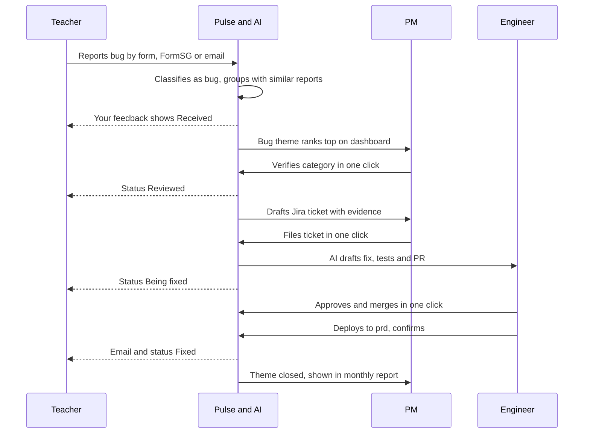
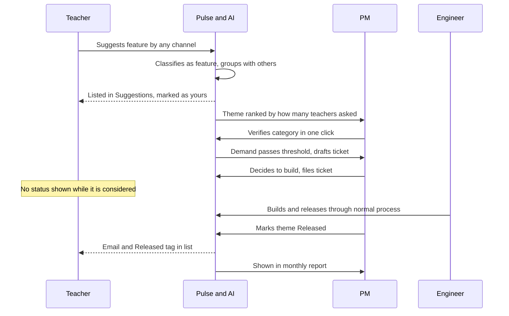
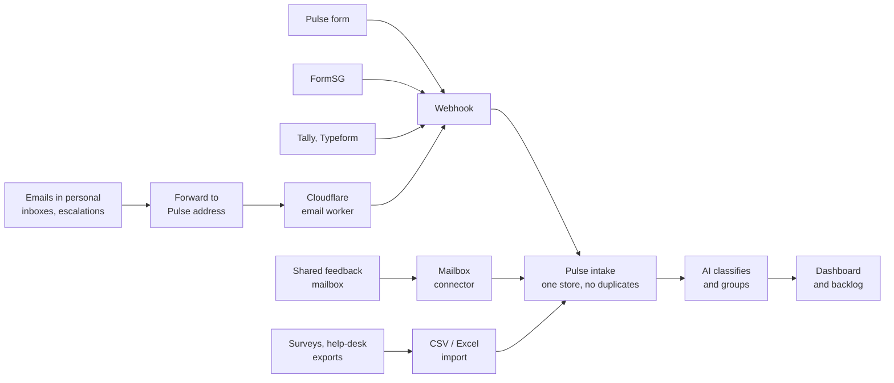
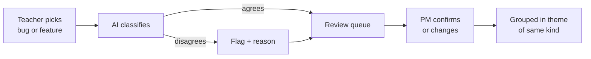
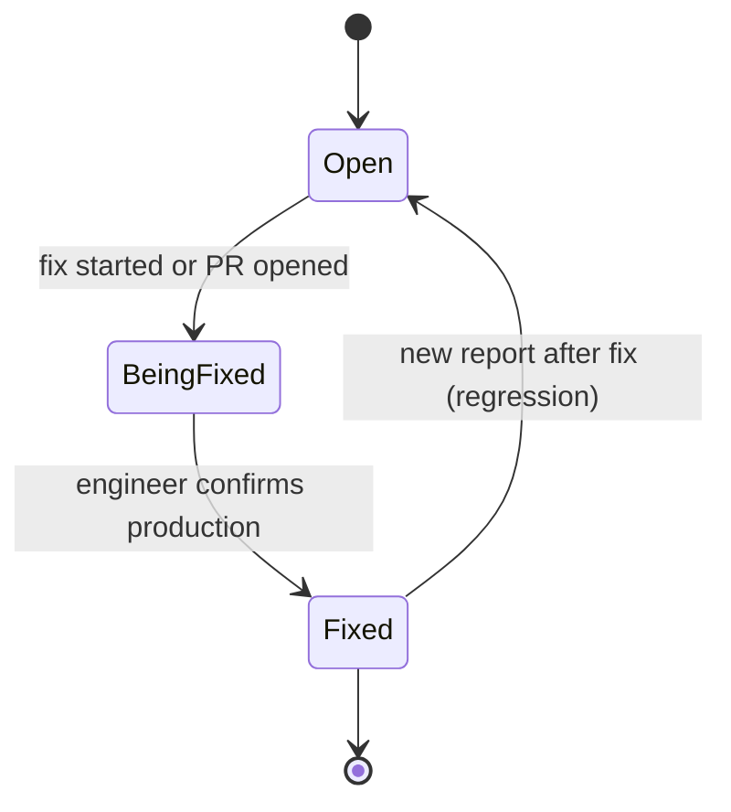
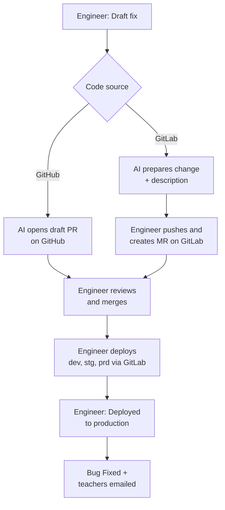

# PRD — Pulse v0.2: Bug & feature loop

24 Sep 2026 · @shipei

## TL;DR and key decisions

Pulse exists so product teams see 100% of their feedback in one place and change products on evidence, not anecdote. The end state is a single feedback channel; until then, Pulse pulls from every existing source.

Pulse v0.2 turns collected feedback into a closed loop: teachers report bugs or suggest features, AI checks the label, a PM makes the final call, and teachers hear back when a bug is fixed or a suggestion ships. It builds on v0.1 (Tan Guang Shin, 18 Jun 2026), which covers multi-channel intake, AI tagging, clustering and search. Owner of v0.2: TBC. Tenant zero stays Teacher's Workspace (TW).

Status today: the core loop is built and compiles, but is not yet deployed. Teacher login, notifications, screenshots and AI code fixes are designed only (see Feature inventory).

| Decision | Choice | Rationale |
| --- | --- | --- |
| Feedback kinds | Submitter picks **Bug** or **Feature**; AI may also say **Other** (praise, question) | Bugs and features are acted on differently and must be ranked differently. |
| Who decides the kind | Three layers: submitter picks → AI can relabel (flagged, with reason) → PM verifies as final | Users mislabel often; AI catches it; a human stays accountable. |
| Grouping | Done by Pulse (AI + PM), never by the submitter | Teachers can't know what others reported; asking them to deduplicate shifts our job onto them. |
| Ranking | Bugs by frequency × severity; features by number of teachers who suggested | Pain matters for bugs; demand matters for features. |
| Voting | None | Demand is counted from grouped mentions across all channels. |
| Status shown to teachers | Bugs: Received → Reviewed → Being fixed → Fixed. Suggestions: only "Released", if ever | A suggestion status reads as a promise the team may not keep. |
| Teacher sign-in | Email sign-in link, MOE domains only | Proves identity without IT approval; MOE SSO can replace it later. |
| Screenshots | Allowed on bug reports, with safeguards | Most useful evidence for a bug; carries student-data risk (see NFRs). |
| AI code fixes | AI drafts a fix and opens a PR on GitHub; a person always reviews, merges and deploys | Keeps production in human hands; fits existing mirroring and GitLab restrictions. |
| "Fixed" means | Deployed to production, confirmed by an engineer | Teachers are only told once they can see the fix. |

## Problem statement

Product teams can't see all the feedback they receive, so changes get pushed by whoever speaks loudest rather than by evidence.

### The bigger problem: collating feedback

Feedback arrives in many forms: FormSG, emails to individuals, surveys, help-desk summaries, escalations and chat groups. Each sits in a different place and nobody owns pulling it together. The people collating it spend hours doing it by hand, and still only see part of it.

So the case for a change becomes "he said I should" or "she said I should". One voice becomes the reason to change a product. That is a suggestion with no data behind it: no count, no trend, and no sense of how many others feel the same.

### What v0.1 left open

v0.1 brings the channels into one store, tagged and grouped. Three gaps remain after collection:

- **Bugs and features are mixed.** One ranking treats "attendance won't save" and "add dark mode" the same way, and AI-only labels go unchecked.
- **Teachers hear nothing back.** They can't see whether a bug they reported was fixed, so they re-report or stop reporting.
- **Acting on it is still manual.** Someone has to file tickets, write reports and start each fix from scattered reports.

The cost: collators lose hours every cycle, decisions rest on anecdotes, real bugs stay open longer, and teachers stop believing feedback matters.

## Goals and non-goals

v0.2 succeeds when a PM can see, in one screen, the top bugs to fix and the top features to build, and every bug reporter is told when their bug is fixed.

### Vision and principles

**End state:** all feedback comes in through one channel, Pulse's own, and is consolidated automatically.

**Until then:** Pulse pulls feedback from every existing source (FormSG, email, surveys, help desk, escalations) and consolidates it, so nothing is missed while teams move over.

- **See 100% before prioritising.** The aim is not to act on the half of feedback we happen to see. It is to see all of it, then decide and prioritise what to change.
- **Evidence over anecdote.** Every change request carries a count, a trend and the voices behind it.
- **Automate the busywork, keep a human eye.** AI classifies, groups, files tickets, writes reports and drafts code fixes; a person oversees and approves every decision that matters.
- **One button to approve.** Routine actions, such as approving a bug fix, filing a ticket or sending a report, take a single click from the person responsible.

### Goals

1. **See all feedback:** 100% of known feedback sources are listed in Pulse, and each is connected or imported.
2. **Separate bugs from features** at intake, with ≥ 90% of items needing no PM change to their final category.
3. **Keep a human as the final judge** of every item's category, with a visible trail of who decided what.
4. **One prioritised dashboard** of every bug to fix and feature to consider, ranked by evidence.
5. **Automate ticketing and reporting:** tickets and periodic reports are drafted by Pulse and approved in one click.
6. **Close the loop for bugs:** every reporter who gave an MOE email is notified when the bug reaches production.
7. **Give teachers one place** to see their own reports and suggestions.
8. **One-click bug fixes:** an engineer approves an AI-drafted, tested fix with a single button (later phase).

### Non-goals (v0.2)

1. **Not a support desk.** No per-ticket replies, SLAs or assignment of individual reports. Status is shown per bug theme, not per report.
2. **No status for suggestions.** Teachers never see "planned" or "under review"; only "Released" if it ships.
3. **No voting or self-deduplication** by teachers.
4. **AI never approves, merges or deploys on its own.** It drafts the fix; an engineer approves and merges it with one click.
5. **No MOE SSO yet.** Email sign-in links first; SSO later with IT approval.
6. **No real teacher data** until the data classification and PDPA review is complete.
7. Carried from v0.1: no auto-changes to any team's backlog, no cross-product benchmarking.

## North star and happy flows

**North star message: every piece of feedback is seen, counted and answered.**

- **For teachers:** say it once, anywhere, and hear back when it's fixed.
- **For PM and tech teams:** see 100% of feedback, decide on evidence, approve with one click.

**North star metric: 14-day decision rate.** The share of feedback items received in a month that have a recorded decision within 14 days of arriving. Starting targets: **60%** in the first pilot month, **85%** by month 3.

```latex
\text{14-day decision rate} = \frac{\text{items decided within 14 days of arrival}}{\text{all items received that month}} \times 100\%
```

An item counts as **decided** only when all three are true, each read straight from Pulse:

1. A PM has verified its category (`verified_at` is set).
2. It belongs to a theme (`theme_id` is set).
3. That theme has a decision: a ticket filed, Being fixed, Fixed, Released, or an internal **Not now** (new internal status, never shown to teachers).

Two guard metrics stop the number being gamed: **source coverage** stays at 100% of the source register (so hidden feedback can't flatter the rate), and **Not now** stays below 50% of decisions (so items aren't parked to hit the target). Example: 200 items arrive in March and 150 are decided within 14 days, so the rate is 75%.

### Happy flow: bug report



The teacher does one thing, reporting; every later step reaches them as a status or email. The team's work is mostly one-click approvals of what Pulse drafted.

### Happy flow: feature suggestion



Teachers only hear back if the feature ships. If the team decides not to build it, the suggestion simply stays in the list with its count.

## Users, roles and user stories

Four roles use Pulse directly; v0.1's indirect "feedback author" becomes a signed-in teacher.

| Role | Sign-in | Can do |
| --- | --- | --- |
| **Teacher / school staff** | None to submit; MOE email link to see own feedback | Report a bug or suggest a feature; attach screenshots; see status of own bugs; see top suggestions with own ones marked. |
| **PM** | Dashboard password (v0.2), MOE SSO later | See ranked bugs and features; verify categories; mark bugs fixed; mark suggestions released; manage channels. |
| **Engineer** | Same as PM, plus GitHub/GitLab access | Review AI-drafted fixes; approve, request changes or discard; confirm deployment to production. |
| **Stakeholder (SEIO, superintendent)** | Read-only dashboard access | View themes and trends for their own reporting. |

### User stories

**Teacher**

- As a teacher, I want to say whether I'm reporting a bug or suggesting a feature, so that it reaches the right place.
- As a teacher, I want to attach a screenshot and tap my device and browser, so that I don't have to describe technical details.
- As a teacher, I want to sign in with my MOE email and see my past reports and suggestions, so that I know what happened to them.
- As a teacher, I want an email when a bug I reported is fixed, so that I know I can use that feature again.

**PM**

- As a PM, I want to see when AI changed a submitter's label and why, so that I can make the final call quickly.
- As a PM, I want bugs ranked by pain and features by demand, side by side, so that I know what to fix and what to build.
- As a PM, I want to mark a suggestion as released, so that everyone who suggested it hears about it.

**Engineer**

- As an engineer, I want an AI-drafted code fix with the teacher reports attached, so that I start from evidence, not a blank page.
- As an engineer, I want to review the fix in GitHub or GitLab as usual, so that Pulse doesn't change how we review code.

## Feature inventory

20 features are built in the code (11 by your friend, 9 added in v0.2); 13 more exist only in the design preview. Nothing is deployed yet.

| # | Feature | Status | Notes |
| --- | --- | --- | --- |
| 1 | Hosted feedback form channel | Built (v0.1) | Shareable link per channel |
| 2 | Webhook channel (Tally, Typeform, Jotform) | Built (v0.1) | Field mapping per channel |
| 3 | FormSG webhook, signature check and decryption | Built (v0.1) | Auto-detects a "bug or feature" question in v0.2 |
| 4 | Email-forward channel | Built (v0.1) | Code exists; needs Cloudflare and a mail domain (v0.1 risk #1) |
| 5 | Add-channel wizard | Built (v0.1) | Generates link, webhook URL or email address |
| 6 | Duplicate-safe intake | Built (v0.1) | Same message never stored twice |
| 7 | AI tagging (area, type, severity, sentiment, summary, original author) | Built (v0.1) | Model changed to Claude Sonnet 5 in v0.2 |
| 8 | Grouping into themes with AI-written theme names | Built (v0.1) | Per category from v0.2 |
| 9 | Semantic search ("do we know this?") | Built (v0.1) | |
| 10 | Theme page with the raw reports | Built (v0.1) | |
| 11 | Multi-product data model with access policies | Built (v0.1) | TW is tenant zero |
| 12 | Bug / feature choice on the form, bug fields, device and browser buttons | Built (v0.2) | Device and browser pre-picked, no versions |
| 13 | AI category check with "AI changed" flag and reason | Built (v0.2) | |
| 14 | PM review queue with "verified by" trail | Built (v0.2) | Changing a category moves the item to the right theme |
| 15 | Bugs ranked by frequency × severity; features by demand | Built (v0.2) | Side by side on the dashboard |
| 16 | Mark bug fixed or reopen; auto-reopen as regression | Built (v0.2) | Open / fixed only; no production link yet |
| 17 | Classification right after submission, live dashboard refresh | Built (v0.2) | |
| 18 | Dashboard password gate | Built (v0.2) | Forms stay public |
| 19 | "Load demo data" button | Built (v0.2) | 26 sample teacher comments |
| 20 | One-paste database setup and setup guide | Built (v0.2) | Tested on Postgres 16 + pgvector |
| 21 | Teacher sign-in with MOE email link | Designed only | |
| 22 | "Your feedback" page: bug status + one suggestions list | Designed only | |
| 23 | Email when a bug is fixed or a suggestion is released | Designed only | Needs an email service |
| 24 | "Released" status for suggestions | Designed only | |
| 25 | Screenshot upload on bug reports | Designed only | Pending PDPA check |
| 26 | AI suggested actions and suggested improvement | Designed only | |
| 27 | Channel breakdown and weekly trend | Designed only | |
| 28 | Add a duplicate report to an existing theme | Designed only | PM action in review queue |
| 29 | Draft Jira issue from a theme | Designed only | v0.1 P1 |
| 30 | AI-drafted code fix with pull request on GitHub | Needs approval | Needs repo access and IT approval |
| 31 | Prepared merge request for GitLab-source projects (e.g. SDT) | Needs approval | Engineer creates the MR by hand |
| 32 | Engineer confirms "on production", which triggers teacher emails | Needs approval | |
| 33 | MOE single sign-on | Needs approval | Replaces email links later |

## Functional requirements

P0 = the v0.2 core loop (built, pending deployment test); P1 = teacher loop, next build; P2 = AI code fixes, after IT approval. v0.1 intake requirements (P0 items 1–9) stay in force unchanged. Each row states when it counts as done.

### Submission form

| ID | Requirement | Actor | Priority |
| --- | --- | --- | --- |
| FR-10 | Submitter must pick **Bug** or **Feature** before submitting. Done when: submit is disabled until picked and the pick is stored as the submitter's category. | Teacher | P0 |
| FR-11 | Bug reports show optional "Where did it happen?" and "What did you expect?" fields, folded into the report text. | Teacher | P0 |
| FR-12 | Device (Computer / Phone / Tablet) and browser (Chrome / Safari / Edge / Not sure) are pre-picked from the browser and editable. No version numbers are captured. | Teacher | P0 |
| FR-13 | Bug reports accept up to 3 screenshots (PNG, JPG or HEIC, max 5 MB each), with a reminder not to include student names or details. | Teacher | P1 |
| FR-14 | When signed in, the form fills in the teacher's email and links the item to them. | Teacher | P1 |
| FR-15 | Webhooks and FormSG can pass the submitter's bug/feature choice through channel mapping. | System | P0 |

### Classification and PM review

| ID | Requirement | Actor | Priority |
| --- | --- | --- | --- |
| FR-20 | AI classifies every item as bug, feature or other, independently of the submitter's pick. | System | P0 |
| FR-21 | When AI disagrees with the submitter, the item is flagged "AI changed from X" and stores a one-sentence reason. | System | P0 |
| FR-22 | A review queue lists every unverified item, AI-changed items first. | PM | P0 |
| FR-23 | PM confirms or changes the category. Done when: the decision is final and records the PM's name and time. | PM | P0 |
| FR-24 | Changing a category moves the item into a theme of the new category; a theme left empty is removed. | System | P0 |
| FR-25 | PM can move a report into an existing theme, or split it out into a new one. | PM | P1 |

### Grouping, ranking and dashboard

| ID | Requirement | Actor | Priority |
| --- | --- | --- | --- |
| FR-30 | Items are only grouped with items of the same category. | System | P0 |
| FR-31 | Open bugs rank by frequency × severity; features rank by the number of distinct submitters across all channels. | System | P0 |
| FR-32 | Dashboard shows bugs, features and other feedback side by side, plus a banner with the review count. | PM | P0 |
| FR-33 | Each theme shows its channel breakdown and reports per week. | PM | P1 |
| FR-34 | AI proposes the week's top 3 actions and a suggested improvement per theme, each labelled as AI-written. | PM | P1 |
| FR-35 | Semantic search over all items and themes. | PM | P0 |

### Bug and suggestion lifecycle

| ID | Requirement | Actor | Priority |
| --- | --- | --- | --- |
| FR-40 | Bug themes move Open → Being fixed → Fixed. v0.2 build has Open and Fixed only. | PM | P0 |
| FR-41 | A new report on a fixed bug, received after its fix date, reopens it and flags a regression. | System | P0 |
| FR-42 | A bug counts as Fixed only once an engineer confirms it is on production. | Engineer | P1 |
| FR-45 | PM can mark a feature theme **Released** with a date. | PM | P1 |
| FR-46 | Any internal planning status on suggestions is visible to the team only, never to teachers. | System | P1 |

### Teacher portal

| ID | Requirement | Actor | Priority |
| --- | --- | --- | --- |
| FR-50 | Teachers sign in with a one-time email link, allowed MOE domains only. Done when: other domains are refused, and links expire after 15 minutes and work once. | Teacher | P1 |
| FR-51 | "Your feedback" lists the teacher's bug reports with their 4-step status. | Teacher | P1 |
| FR-52 | One suggestions list shows the top 20 themes by demand, with counts. The teacher's own suggestions are marked with the date and always listed; tapping one shows what they wrote. | Teacher | P1 |
| FR-53 | Teachers only ever see theme names and counts, never another teacher's words, name or email. | System | P1 |

### Notifications

| ID | Requirement | Actor | Priority |
| --- | --- | --- | --- |
| FR-60 | Everyone who reported a bug with an email gets one email when it is Fixed. | System | P1 |
| FR-61 | Everyone who suggested a feature gets one email when it is Released. | System | P1 |
| FR-62 | Every email has an unsubscribe link; Pulse sends no other emails. | System | P1 |

### AI-suggested code fixes

| ID | Requirement | Actor | Priority |
| --- | --- | --- | --- |
| FR-70 | Each product records where its code lives: GitHub-source (mirrored to GitLab) or GitLab-source (e.g. SDT), plus repo and branch. | Admin | P2 |
| FR-71 | GitHub-source: engineer clicks "Draft fix"; AI writes the change and a test on a new branch, then opens a draft PR that links the teacher reports and follows the team's PR template. | Engineer | P2 |
| FR-72 | GitLab-source: AI prepares the change and description; a button opens GitLab's new merge request page and the engineer pushes and creates it. | Engineer | P2 |
| FR-73 | The fix screen shows the AI's explanation, the code changes, checks and PR/MR status, with Review in GitHub/GitLab, Approve, Request changes and Discard. | Engineer | P2 |
| FR-74 | AI cannot approve, merge or deploy. Done when: its credentials have no merge or deploy rights. | System | P2 |
| FR-75 | Engineer clicks "Deployed to production", which sets the bug to Fixed and triggers FR-60. | Engineer | P2 |

### Coverage, automation and oversight

| ID | Requirement | Actor | Priority |
| --- | --- | --- | --- |
| FR-90 | A **source register** lists every known feedback source, connected or not (FormSG forms, inboxes, surveys, help desk, escalations), with owner, connection status and share of volume. | PM | P1 |
| FR-91 | Sources that can't connect yet are brought in by **import** (CSV or Excel exports from surveys and help-desk reports), mapped once and reused. | PM | P1 |
| FR-92 | **Prioritised backlog view:** one ranked list of every open bug and feature, with evidence (count, trend, severity, channels), status and owner; filter and export. | PM | P0 |
| FR-93 | **Automated ticketing:** when a verified theme crosses a threshold (e.g. ≥ 5 reports, or any critical bug), Pulse drafts a Jira ticket with the evidence; the PM files it in one click. The ticket updates as new reports arrive. | PM | P1 |
| FR-94 | **Automated reporting:** a weekly digest and monthly readout (highlights, ranked themes, suggested priority changes) are generated automatically; the PM reviews and sends in one click. | PM | P1 |
| FR-95 | **Oversight:** every automated step (classify, group, ticket, report, fix) is shown as AI-made until a person approves it, and any step can be undone. | PM, Engineer | P1 |
| FR-96 | **One-click fix approval:** when an AI-drafted fix has passed all required checks, the engineer approves and merges it from Pulse with one button, under their own name. Repo rules (required reviewers, branch protection) still apply. | Engineer | P2 |
| FR-97 | **Moving to one channel:** Pulse shows the share of feedback arriving through its own channel over time, per product. | PM | P1 |

### Email intake

Decision: email reaches Pulse two ways, both landing as the same "email" source. A **shared feedback mailbox** is read directly for mail sent to the team; a **Cloudflare forwarding address** catches feedback that lands anywhere else. Pulse never reads personal inboxes.

| ID | Requirement | Actor | Priority |
| --- | --- | --- | --- |
| FR-98 | **Shared mailbox connector:** Pulse reads new mail from one IT-approved shared mailbox only, notified on arrival where the provider supports it, otherwise checked every 5 minutes. | System | P1 |
| FR-99 | Access is limited to that mailbox; Pulse cannot read, send from or change any other mailbox. Done when: IT confirms the permission scope. | System | P1 |
| FR-100 | **Duplicate check across channels:** an email arriving through both the mailbox and a forward is stored once, matched on its unique message ID within a product. | System | P1 |
| FR-101 | **Forwarding address** (built by v0.1): each email channel gets its own address; quoted history and signatures are stripped, the original sender is found, and only allowed sender domains are accepted. | System | P0 |

### Access

| ID | Requirement | Actor | Priority |
| --- | --- | --- | --- |
| FR-80 | Dashboard, review, channels and search need sign-in; feedback forms stay public. v0.2 uses one shared password. | System | P0 |
| FR-81 | Separate roles for PM, Engineer and read-only Stakeholder, each with named accounts. | Admin | P1 |

## Non-functional requirements

These targets are proposals for the team to confirm. Security and privacy items are release blockers for any real teacher data.

### Security

| ID | Requirement | Target |
| --- | --- | --- |
| NFR-1 | Secrets (database, AI, email, Git tokens) live only in hosting environment settings, never in code or the browser. | 0 secrets in the repo; checked in code review |
| NFR-2 | Every row is scoped to its product; staff only see products they belong to. | Row-level security on all tables; tested per role |
| NFR-3 | Teachers can only read their own reports and the public theme list. | Access test: teacher A cannot open teacher B's item by ID |
| NFR-4 | Sign-in links are single-use and short-lived; sessions use secure, httpOnly cookies. | Link expiry 15 min; session 14 days |
| NFR-5 | Public endpoints (form, webhooks, sign-in) are rate-limited. | e.g. 10 submissions per minute per IP; tuned after pilot |
| NFR-6 | Feedback text is treated as data, never as instructions, in every AI prompt (protects against prompt injection). | Red-team test with 20 malicious submissions before P2 |
| NFR-7 | Git credentials for AI fixes are least-privilege: create branches and draft PRs on GitHub only, no merge, no GitLab, no deploy. | Verified by IT before P2 goes live |
| NFR-8 | Uploads are checked for file type and size, and served only through signed, expiring links. | Signed URL lifetime ≤ 10 min |

### Privacy and data protection

| ID | Requirement | Target |
| --- | --- | --- |
| NFR-10 | Data classification and PDPA review completed before real teacher data is used (v0.1 risk #4). | Sign-off recorded |
| NFR-11 | Collect the minimum: device type and browser name only, no versions, IP addresses or tracking. | Reviewed against form fields |
| NFR-12 | Screenshots are private to PM and engineers and deleted automatically. | Deleted 90 days after the bug is fixed (to confirm) |
| NFR-13 | Teachers are told what is collected and why, on the form. | One plain-language line on the form |
| NFR-14 | Every staff action on an item (verify, relabel, merge, fix, release) is logged with who and when. | Audit trail kept for 1 year (to confirm) |
| NFR-15 | A teacher's data can be deleted on request. | Delete within 30 days of request |

### Performance and scale

| ID | Requirement | Target |
| --- | --- | --- |
| NFR-20 | Form submission responds quickly. | < 2 s at p95 |
| NFR-21 | New items are classified and grouped soon after arrival. | < 60 s at p95 |
| NFR-22 | Dashboard and search stay fast as data grows. | < 2 s dashboard, < 1 s search at 50,000 items per product |
| NFR-23 | Supports several products on one deployment (v0.1 goal 4). | 10 products without schema change |

### Reliability

| ID | Requirement | Target |
| --- | --- | --- |
| NFR-30 | No feedback is lost: intake is saved before any AI step, and failed AI steps retry. | 0 lost items; up to 3 retries, then flagged for a person |
| NFR-31 | AI or email outages never block submissions. | Form works with AI provider down |
| NFR-32 | Data is backed up. | Daily backups, 7-day restore window |
| NFR-33 | Availability during school hours. | 99.5% monthly, 7am–7pm SGT |

### Accessibility and usability

| ID | Requirement | Target |
| --- | --- | --- |
| NFR-40 | Meets accessibility standards. | WCAG 2.1 AA |
| NFR-41 | Form works well on phones. | Usable at 360 px width; tap targets ≥ 44 px |
| NFR-42 | Plain language for teachers; no technical terms on teacher screens. | Reviewed by a teacher before pilot |
| NFR-43 | Supported browsers. | Latest 2 versions of Chrome, Edge, Safari (incl. iPad) |

### AI quality and oversight

| ID | Requirement | Target |
| --- | --- | --- |
| NFR-50 | Category accuracy, measured against PM decisions. | ≥ 90% of AI categories kept by the PM |
| NFR-51 | All AI-written content is labelled as AI and can be overridden by a person. | 100% of AI text labelled |
| NFR-52 | AI costs are tracked per product. | Monthly report; alert at a set budget |

### Hosting and operations

| ID | Requirement | Target |
| --- | --- | --- |
| NFR-60 | Production runs on approved government hosting (GCC), following the SuMS path (v0.1 risk #3). | IT approval before production |
| NFR-61 | Errors are visible to the team. | Failed items and error counts shown on an admin page |

## Data model and flows

v0.2 extends v0.1's four tables rather than replacing them. Migration `0004_bug_feature_review.sql` holds the built columns; the rest are proposed.

| Table | Change | Status |
| --- | --- | --- |
| `feedback` | `category`, `user_category`, `ai_category`, `ai_reason`, `ai_corrected`, `review_status`, `verified_by`, `verified_at`; new `processing` status | Built |
| `themes` | `category`, `status` (open / fixed), `fixed_at`, `regressed` | Built |
| `themes` | Add `being_fixed` and `released` statuses, `released_at` | Proposed |
| `feedback` | `submitter_email` (normalised), `submitter_id` | Proposed |
| `attachments` (new) | `feedback_id`, storage path, type, size, `delete_after` | Proposed |
| `notifications` (new) | recipient, theme, kind (fixed / released), `sent_at`; one row per person per event | Proposed |
| `fix_proposals` (new) | `theme_id`, explanation, branch, PR/MR link, status, `deployed_at`, `deployed_by` | Proposed |
| `products` | `code_source` (github / gitlab), repo, default branch | Proposed |
| `audit_log` (new) | actor, action, item or theme, before, after, time | Proposed |

### How feedback comes together



Every source ends in the same intake, so the dashboard counts all feedback together. Built today: Pulse form, FormSG, Tally and Typeform webhooks, and the Cloudflare forwarding path; the mailbox connector and imports are proposed (FR-98, FR-91).

### Classification flow



Items appear on the dashboard as soon as AI has classified them; PM verification can follow later.

### Bug lifecycle



Teachers are emailed only on the move to Fixed.

### AI fix flow by code source



GitHub-source projects mirror to GitLab automatically, so Pulse never needs GitLab access for them.

## Success metrics

Measured over the first 8 weeks of a TW pilot; targets are proposals to confirm.

| Metric | Target | Type |
| --- | --- | --- |
| Known feedback sources connected or imported | 100% of the source register | Leading |
| Share of feedback arriving through Pulse's own channel | Rising each quarter toward 100% | Lagging |
| Collator time spent compiling feedback per month | Down ≥ 75% vs. today (baseline to measure) | Lagging |
| Change requests backed by a count and trend | 100% of those taken to prioritisation | Lagging |
| Items whose AI category the PM keeps | ≥ 90% | Leading |
| Items verified by a PM within 5 working days | ≥ 80% | Leading |
| Tickets and reports drafted by Pulse, not by hand | ≥ 90% | Leading |
| Bug reports that include device and browser | ≥ 90% | Leading |
| Bug reporters notified when their bug is fixed | 100% of those who gave an email | Leading |
| Teachers who sign in to "Your feedback" at least once | ≥ 30% of reporters with an email | Leading |
| Median days from first report to Fixed, for top-5 bugs | Down vs. the pilot's first month | Lagging |
| AI-drafted fixes approved with one click, no edits (P2) | ≥ 50% | Lagging |

## Dependencies, risks, phasing and open questions

### Dependencies and risks

v0.1 risks 1–6 still apply; these are new in v0.2.

| # | Risk | Impact | Mitigation |
| --- | --- | --- | --- |
| 7 | Screenshots show student names or marks | Personal data exposure | Form reminder, private storage, auto-deletion, PDPA review first (NFR-10, NFR-12) |
| 8 | School mail filters hold back sign-in or notification emails | Teachers can't sign in or miss updates | Test with real MOE inboxes early; send from an approved address |
| 9 | Teachers read suggestion counts as a commitment | Disappointment, pressure on the roadmap | No status except Released; copy reviewed by a teacher (NFR-42) |
| 10 | AI-drafted fixes are wrong or unsafe | Wasted review time, bugs introduced | Draft PRs only, tests required, human review and merge (FR-74) |
| 11 | IT does not approve repo access for AI | P2 blocked | P0–P1 stand alone; P2 is optional |
| 12 | Mirroring direction differs per project | Wrong PR flow | Per-product `code_source` setting (FR-70) |
| 13 | Shared dashboard password leaks | Unauthorised access | Named accounts and roles in P1 (FR-81) |

### Phasing

- **Phase A — Deploy v0.2 core (this week).** Deploy the zip, load demo data, test the P0 loop end to end. *Exit: live demo link.*
- **Phase B — Teacher loop (about 2 weeks).** MOE email sign-in, "Your feedback", Released status, notifications, screenshots, named staff accounts. *Exit: a TW teacher reports a bug and gets an email when it's fixed.*
- **Phase C — Coverage and automation (about 2 weeks).** Source register and imports, prioritised backlog view, automated tickets and reports, suggested actions and improvements, channel and trend views, merge and split. *Exit: weekly readout comes from Pulse.*
- **Phase D — AI fixes (after IT approval).** Code source setting, draft PRs on GitHub, one-click approve and merge, prepared MRs for GitLab-source projects, production confirmation. *Exit: one real bug fixed from an AI draft.*
- **Before real data:** PDPA sign-off (NFR-10) and GCC hosting approval (NFR-60).

### Open questions

- [ ] **[Eng]** Does TW mirror GitHub → GitLab, or GitLab → GitHub like SDT? Decides the Phase D flow first.
- [ ] **[Product]** Which email domains may sign in: `@moe.edu.sg`, `@moe.gov.sg`, others?
- [ ] **[IT]** Which email service or sender address is approved for teacher emails?
- [ ] **[Security/Legal]** Retention for screenshots and the audit log (proposed: 90 days after fix; 1 year).
- [ ] **[Security/IT]** Is an AI tool allowed read access to the TW repository and draft-PR rights on GitHub?
- [ ] **[Product]** Who owns v0.2, and does it merge into the v0.1 PRD or stay a separate addendum?
- [ ] **[Stakeholder]** Should stakeholders see teacher-level detail, or themes only?
- [ ] **[Product]** Which feedback sources exist today for TW, and who owns each? Needed to fill the source register (FR-90).
- [ ] **[Eng]** Do repo rules allow merging from Pulse with one button (FR-96), or must approval happen inside GitHub?
- [ ] **[Product]** What threshold should auto-draft a ticket (FR-93): a fixed count, or relative to each product's volume?
- [ ] **[IT]** Is the team's email on Outlook (Microsoft 365) or Gmail, and can Pulse be granted read access to one shared feedback mailbox (FR-98)?
